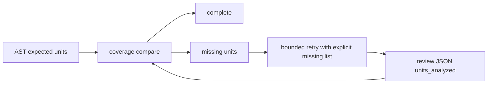
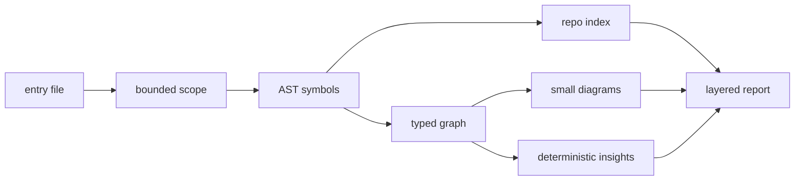
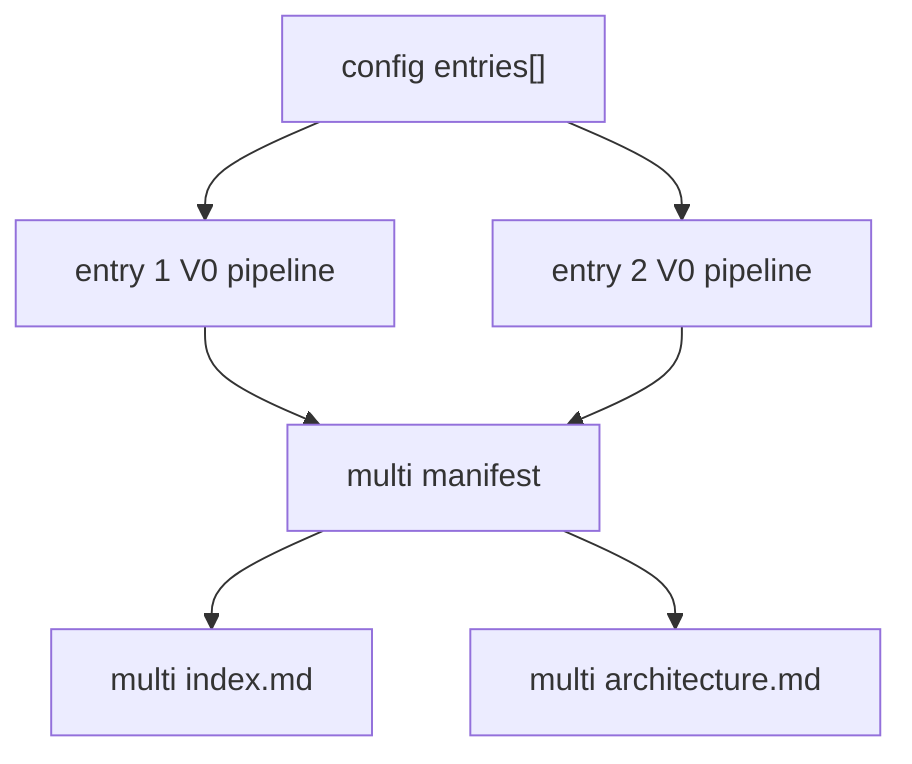

# prism

`prism` is a deterministic review and static-analysis harness for reliability-focused codebases.

It has three primary capabilities:

| Capability | Command | Purpose | LLM use |
| --- | --- | --- | --- |
| Pull request review | `prism review <pr-number>` | Review every AST-derived reviewable unit in a GitHub PR, enforce coverage, and optionally post the result back to GitHub. | Claude is used for classification, review, aggregate reporting, and PR architecture narrative. Coverage is computed by code. |
| Static analysis | `prism analyze ...` | Analyze one entrypoint or a bounded set of entrypoints in a repo and produce deterministic architecture maps, symbol/module directories, diagrams, insights, and reports. | No LLM. All facts come from source, AST extraction, import traversal, and deterministic graph logic. |
| Repo knowledge | `prism knowledge build` | Package existing `prism analyze` artifacts into compact deterministic knowledge outputs for reuse in future sessions and docs. | No LLM. Facts are loaded from existing Prism artifacts and validated on disk. |

The core promise is the same in both modes: disk-backed stages, deterministic inputs and outputs, bounded work, inspectable failures, and safe reruns.

## Why

LLM reviews are often one-shot and vague. Repository architecture notes are often handwritten and stale. `prism` keeps both workflows grounded in persisted facts:

- **Reproducible**: same inputs follow the same pipeline shape.
- **Resumable**: every stage writes to disk; reruns reuse completed outputs by default.
- **Bounded**: concurrency, retries, iterations, traversal depth, and scoped files have explicit limits.
- **Verifiable**: PR review coverage is computed from AST ground truth, not LLM self-report.
- **Inspectable**: raw artifacts, intermediate JSON, diagrams, and final Markdown reports remain on disk.

## Setup

```bash
bun install
bun link
```

After `bun link`, the `prism` command is available globally. You can also run it directly:

```bash
bun /path/to/prism/bin/prism --help
```

## Capability Map

```mermaid
flowchart TD
  Prism["prism CLI"]
  Prism --> Review["PR review"]
  Prism --> Analyze["Static analysis"]
  Prism --> Knowledge["Repo knowledge"]

  Review --> RFetch["fetch GitHub PR facts"]
  Review --> RUnits["enumerate reviewable units"]
  Review --> RClassify["route files/units to reviewers"]
  Review --> RReview["run bounded Claude reviews"]
  Review --> RCoverage["verify coverage from AST units"]
  Review --> RFinal["aggregate and post"]

  Analyze --> AScope["scope files from entrypoints"]
  Analyze --> ASymbols["extract symbols"]
  Analyze --> ARepoIndex["build repo index"]
  Analyze --> AGraph["build typed graph"]
  Analyze --> ADiagrams["render small diagrams"]
  Analyze --> AReport["write reports"]

  Knowledge --> KLoad["load analyze manifests/artifacts"]
  Knowledge --> KPack["build knowledge pack + index"]
  Knowledge --> KValidate["validate links and refs"]
```



## PR Review

Run from the repository that owns the pull request:

```bash
prism review 1234
prism review 1234 --post
prism review 1234 --edit
```

`--post` creates a PR comment. `--edit` updates the latest existing Prism comment instead.

### PR Review Pipeline

```text
fetch -> enumerate -> classify -> review -> coverage -> aggregate -> architecture -> post
 (gh)    (ts-morph)   (claude)   (claude)   (logic)    (claude)    (claude)       (gh)
```

Each stage reads its inputs from disk, writes outputs to disk, and skips existing outputs unless forced.

| Stage | Responsibility | Main output |
| --- | --- | --- |
| `fetch` | Capture GitHub PR metadata, changed files, and full diff. | `raw/`, `diffs/` |
| `enumerate` | Extract reviewable units from changed TS/JS files with `ts-morph`. | `units/*.json` |
| `classify` | Route files/units to reviewer profiles. | `tasks/*.json` |
| `review` | Run bounded Claude reviewer calls and validate JSON output. | `reviews/*.json` |
| `coverage` | Compare expected AST units with `units_analyzed`. | `coverage/*.json` |
| `aggregate` | Produce the final PR review report. | `final/pr-review-<pr>.md` |
| `architecture` | Produce an architecture-oriented PR report. | `final/pr-architecture-<pr>.md` |
| `post` | Create or update the GitHub PR comment when requested. | GitHub comment |

### Reviewable Units

For TS/JS files, `enumerate` extracts:

| Kind | Detection rule |
| --- | --- |
| `function` | Function declarations and arrow/function expressions |
| `component` | PascalCase function returning JSX |
| `hook` | Function named `use*`, for example `useAuth` |
| `class` | Class declarations |
| `method` | Class methods, named `ClassName.methodName` |

Files without extractable TS/JS units are recorded in `units/` with `units: null` and a reason. Current PR review fan-out runs for files with extracted units; non-TS/JS file-level review is recorded as a gap rather than silently treated as covered.

### Coverage Loop

Claude reviewers return `units_analyzed`. Prism does not trust that as coverage proof. It compares those names against the AST-derived expected units for each routed review task.



If units are missing, Prism retries the reviewer with the missed unit list, merges results, and recomputes coverage. The retry loop is capped by `PRISM_MAX_ITER`.

### PR Review Output

By default output lands in `./.tmp/pr-<number>/`, or under `PRISM_WORKDIR` if set:

```text
.tmp/pr-1234/
├── raw/
├── diffs/
├── units/
├── reviews/
├── coverage/
├── tasks/
└── final/
    ├── pr-review-1234.md
    └── pr-architecture-1234.md
```

### Resume And Force

```bash
prism review 1234
prism review 1234 --force
prism review 1234 --force-stage review
```

`--force-stage` accepts `fetch`, `enumerate`, `classify`, `review`, `coverage`, `aggregate`, or `architecture`.

## Static Analysis

`prism analyze` is the deterministic static-analysis command for a bounded repo slice. It is designed for questions like:

- What files and symbols are pulled in by this entry component?
- Which components, hooks, contexts, stores, services, constants, functions, classes, methods, and types are present?
- Which route maps, provider boundaries, store surfaces, and service flows can Prism prove from source?
- Which entrypoints overlap at the folder/domain level?
- Where are extraction gaps, unresolved imports, cycles, large hubs, or empty diagrams?

### Static Analysis Pipeline

```text
scope -> symbols -> repo-index -> graph -> diagrams -> insights -> report
```



| Stage | Responsibility | Output |
| --- | --- | --- |
| `scope` | Resolve the entrypoint and files reachable through TS/JS imports up to `--depth`, filtered by include/exclude patterns. | `scope/scope.json` |
| `symbols` | Parse TS/JS/TSX/JSX files and extract source symbols. | `symbols/ast-manifest.json`, `symbols/symbols.json` |
| `repo-index` | Build a compact file/symbol directory for reading and aggregate architecture summaries. | `repo-index/repo-index.json` |
| `graph` | Build typed nodes and edges from symbols and references. | `graph/references.json`, `graph/graph.json` |
| `diagrams` | Render deterministic Mermaid diagrams from graph edges. | `diagrams/*.md` |
| `insights` | Run deterministic checks over graph and diagrams. | `insights/insights.json` |
| `report` | Write guided Markdown pages plus a full deterministic report. | `final/index.md`, `final/pages/*.md`, `final/analysis.md` |

### Single-Entry Analysis

```bash
prism analyze --entry src/app/page.tsx --depth 3
prism analyze --entry src/app/page.tsx --depth 3 --include "src/app/**,src/components/**" --exclude "generated/**"
```

### Config-Driven Analysis

Use repo-local config files for repeatable runs:

```bash
prism analyze --config .prism/analyze/root.json
prism analyze --config .prism/analyze/root.json --force
```

Single-entry config:

```json
{
  "entry": "src/app/page.tsx",
  "depth": 3,
  "maxFiles": 1000,
  "include": ["src/app/**", "src/components/**"],
  "exclude": ["generated/**"]
}
```

Multi-entry config:

```json
{
  "entries": [
    { "path": "src/app/page.tsx", "name": "root" },
    { "path": "src/app/admin/page.tsx", "name": "admin" }
  ],
  "depth": 3,
  "maxFiles": 1000,
  "include": ["src/app/**", "src/components/**"],
  "exclude": ["generated/**"]
}
```

See [`docs/examples/analyze-multi-entry.json`](docs/examples/analyze-multi-entry.json) for a reusable example.

Config can set `entry` or `entries[]`, `depth`, `maxFiles`, `include`, and `exclude`. Explicit CLI flags override config values.

### Scope Controls

| Control | Meaning |
| --- | --- |
| `--depth <n>` | Maximum import/re-export traversal depth from each entry. Default: `2`. |
| `--max-files <n>` | Scope budget guard. Default: `1000`. Runs fail before symbol extraction when over budget. |
| `--include <patterns>` | Comma-separated allowlist globs. If omitted, all resolved project files are eligible. |
| `--exclude <patterns>` | Comma-separated denylist globs. |
| `--force` | Rerun all stages. |
| `--force-stage <name>` | Rerun one analyze stage: `scope`, `symbols`, `repo-index`, `graph`, `diagrams`, `insights`, or `report`. |

Patterns support `*` and `**`. The entry file is always included.

### What Static Analysis Extracts

The analyzer follows TS/JS imports and re-exports from each entrypoint and extracts:

- files, imports, and exports
- React components and hooks
- React context objects, providers, and consumers
- Zustand-style stores, state fields, getters, and actions
- services and integration/persistence/API-oriented functions
- functions, constants, classes, methods, and types

Graph edges include:

- `imports`, `exports`, `renders`, `wraps`
- `calls`, `uses_hook`, `uses_context`, `provides_context`
- `reads_constant`, `uses_type`
- `uses_store`, `reads_store`, `writes_store`
- `store_has_state`, `store_has_getter`, `store_has_action`, `invokes_store_action`
- `selects_by`, `routes_to`, `fallback_routes_to`

Import resolution supports TS/JS extensions, common compound sidecars such as `.types.ts`, `.styles.ts`, `.helpers.ts`, and `.constants.ts`, plus simple `baseUrl` and `paths` mappings from `tsconfig.json` or `jsconfig.json`.

### Static Analysis Output

Single-entry output lands in `./.tmp/analyze/<entry-depth-run-id>/`:

```text
.tmp/analyze/<entry-depth-run-id>/
├── raw/
│   └── entry.json
├── scope/
│   └── scope.json
├── symbols/
│   ├── ast-manifest.json
│   └── symbols.json
├── repo-index/
│   └── repo-index.json
├── graph/
│   ├── references.json
│   └── graph.json
├── diagrams/
│   ├── manifest.json
│   ├── component-tree.md
│   ├── provider-stack.md
│   ├── hook-flow.md
│   ├── state-store-map.md
│   ├── store-surface.md
│   ├── service-flow.md
│   ├── context-boundaries.md
│   ├── route-map.md
│   └── import-map.md
├── insights/
│   └── insights.json
└── final/
    ├── index.md
    ├── pages/
    │   ├── 00-entry-overview.md
    │   ├── 01-entry-provider-stack.md
    │   ├── 02-route-map.md
    │   ├── 03-context-boundaries.md
    │   ├── 04-hook-flow.md
    │   ├── 05-state-store-map.md
    │   ├── 06-store-surface.md
    │   ├── 07-extraction-gaps.md
    │   ├── 08-service-flow.md
    │   ├── 09-debug-artifacts.md
    │   ├── 10-interpretation-guide.md
    │   ├── 11-symbol-directory.md
    │   └── 12-module-directory.md
    └── analysis.md
```

Start single-entry reading from `final/index.md`. It links the symbol directory, module directory, focused pages, diagrams, debug artifacts, and full deterministic report.

### Multi-Entry Analysis

Multi-entry analysis runs the same single-entry pipeline once per entry, sequentially, then writes a small aggregate wrapper:



Multi-entry output lands in `./.tmp/analyze/multi/<config-digest>/`:

```text
.tmp/analyze/multi/<config-digest>/
├── manifest.json
├── index.md
└── architecture.md
```

`manifest.json` is the machine-readable run index. `index.md` is the starting point for human navigation. `architecture.md` is a deterministic cross-entry overview built from successful entries' `repo-index.json` files.

The multi-entry architecture page includes:

- entry cards with scope size and dominant symbol types
- relative size comparison by files, symbols, and graph edges
- domain groups and top modules per entry
- shared folder prefixes with broad roots filtered out
- different-domain summaries
- skipped failed entries
- reading links to each entry report, symbol directory, module directory, and repo index

Multi-entry analysis intentionally does not merge graphs, deduplicate symbols across entries, or infer runtime coupling. Failed entries are recorded in the manifest and index while successful sibling entries remain usable.

### Static Analysis Limits

Static analysis can prove extracted source facts. It cannot prove runtime behavior, correctness, performance, security, or complete repo understanding. Missing edges are not proof that no relationship exists. Empty diagrams, unresolved imports, and extraction gaps are surfaced explicitly instead of being guessed.

## Repo Knowledge

`prism knowledge build` packages existing `prism analyze` outputs into a deterministic, disk-backed repo knowledge layer.

```bash
prism knowledge build \
  --analyze-root .tmp/analyze \
  --docs-root docs/prism \
  --out .prism/knowledge
```

Defaults:

- `--analyze-root`: `.tmp/analyze`
- `--docs-root`: `docs/prism`
- `--out`: `.prism/knowledge`
- `--force`: rewrites outputs even when unchanged

Output files:

```text
.prism/knowledge/
├── knowledge-pack.json
├── artifacts-index.json
└── validation-report.md
```

V0 non-goals:

- not a chatbot
- no Postgres requirement
- no Obsidian requirement
- no LLM-inferred architecture facts
- no graph-merge guessing
- no PR review pipeline changes
- no weakened analyze determinism

## CLI Options

```text
prism review <pr-number> [options]
prism analyze (--entry <path> | --config <path>) [options]
prism knowledge build [options]

Options:
  --force              Force re-run of all stages
  --force-stage <name> Force re-run of a single stage
  --post               Post review comment to GitHub
  --edit               Edit latest Prism PR comment instead of creating one
  --resume             Alias for default resumable behavior
  --entry <path>       Analyze command: entry file path
  --config <path>      Analyze command: JSON config defaults
  --depth <n>          Analyze command: traversal depth
  --max-files <n>      Analyze command: scoped file budget
  --include <patterns> Analyze command: comma-separated include globs
  --exclude <patterns> Analyze command: comma-separated exclude globs
  --analyze-root <path> Knowledge command: analyze artifacts root
  --docs-root <path>    Knowledge command: docs root for artifact-link validation
  --out <path>          Knowledge command: output root
```

## Environment

| Env var | Default | Effect |
| --- | --- | --- |
| `PRISM_WORKDIR` | `.tmp` | Output root joined under the repo cwd. |
| `PRISM_CONCURRENCY` | `4` | Max parallel reviewer calls for PR review. |
| `PRISM_MAX_RETRIES` | `3` | Claude call retries on validation failure. |
| `PRISM_MAX_ITER` | `2` | PR review coverage retry-loop iterations. |
| `PRISM_CLAUDE_BIN` | `claude` | Path to the Claude CLI. |
| `PRISM_GH_BIN` | `gh` | Path to the GitHub CLI. |
| `PRISM_VERBOSE` | `0` | `1` enables detailed logs. |

## Development

```bash
bun run format:check
bun run typecheck
bun test
```

`prism` is intentionally small-dependency TypeScript:

- `ts-morph` for AST inspection
- `zod` for schema validation
- `p-limit` for bounded reviewer concurrency

## Documentation

- [`docs/analyze-v0.md`](docs/analyze-v0.md): single-entry static analysis contract.
- [`docs/analyze-v1.md`](docs/analyze-v1.md): multi-entry orchestration contract.
- [`docs/analyze-roadmap.md`](docs/analyze-roadmap.md): current static-analysis roadmap/status.
- [`docs/knowledge-v0.md`](docs/knowledge-v0.md): repo knowledge packaging contract.
- [`docs/model-usage.md`](docs/model-usage.md): model-selection guidance for development work.
