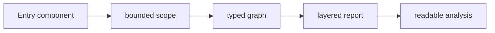

# Static Analysis Roadmap

V0 is effectively complete after docs polish. The shipped analyzer is bounded, deterministic, resumable, disk-backed, and useful on a single React/Next.js slice.

Current smoke run: 439 files, 1360 symbols, 3194 edges, 9 diagrams, 94 insights.

## Current Shape

## V0 Status

| Area | Status |
| --- | --- |
| Engine | Complete |
| Report UX | Complete enough for handoff |
| Reliability/docs | Complete after this pass |

V0 means: analyze one repo slice from one entry point and read the output without needing internal context.

V0 now includes:

- bounded scope
- symbols
- graph
- diagrams
- deterministic insights
- layered report pages
- route, context, hook, store, store-surface, and service pages
- extraction gaps
- source refs on guided pages 03-08
- interpretation guide
- config presets
- AST fixture hardening

## V1 Plan

V1 implementation now lives in [`docs/analyze-v1.md`](./analyze-v1.md). The shipped slice keeps multi-entry orchestration conservative: sequential existing V0 runs plus a separate aggregate index, with no merged repo graph yet.

## Later

Anything beyond V1 is still speculative. If Prism needs a repo architecture map, that should be treated as follow-on scope after V1 lands.
