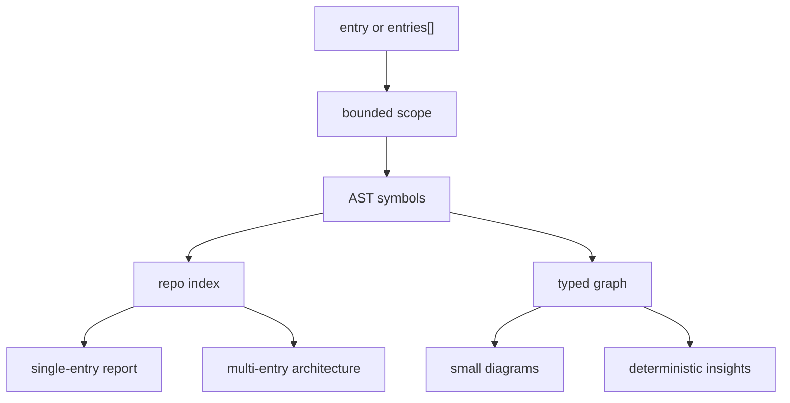
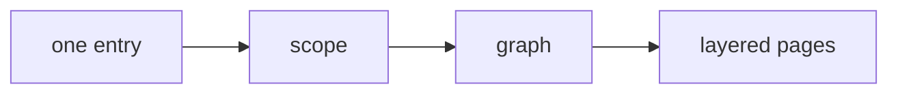
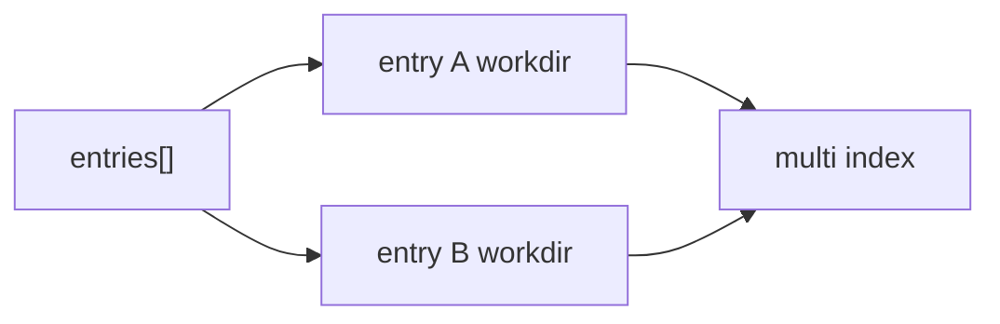

# Static Analysis Roadmap

Prism static analysis is no longer just a V0 experiment. The current shipped analyzer can inspect one entrypoint, inspect multiple entrypoints from one config, and produce a deterministic aggregate architecture overview without asking an LLM to infer structure.

## Current Capability



Current validated shape from the Arcana dashboard-risk config:

| Entry | Files | Symbols | Edges | Insights |
| --- | ---: | ---: | ---: | ---: |
| `dashboard-risk-analysis-views` | 452 | 1411 | 3282 | 94 |
| `chart-tabs-v2` | 34 | 71 | 199 | 15 |

## Version Status

| Version | Status | Capability |
| --- | --- | --- |
| V0 | Done | Single-entry bounded static analysis with symbols, graph, diagrams, insights, layered Markdown report, symbol directory, module directory, and repo index. |
| V1 | Done | Multi-entry config and sequential orchestration that preserves isolated per-entry V0 workdirs. |
| V2 | Done | Repo-index-backed symbol and module directories for readable inventory and aggregate summaries. |
| V3 | Done | Multi-entry `architecture.md` derived from successful entries' repo indexes. |
| V4 | Not started | Better action/data-flow extraction, richer filtering, and targeted report usability improvements. |

## V0

V0 answers: "What does this entrypoint pull into scope, and what can Prism prove from the source?"



See [`docs/analyze-v0.md`](./analyze-v0.md).

## V1

V1 answers: "Can I analyze several entrypoints from one stable config without merging their facts?"



See [`docs/analyze-v1.md`](./analyze-v1.md).

## V2

V2 answers: "How do I read a large slice without opening every diagram first?"

It adds:

- `repo-index/repo-index.json`
- `final/pages/11-symbol-directory.md`
- `final/pages/12-module-directory.md`
- entry overview links into the directories
- module/domain summaries used by the multi-entry architecture page

## V3

V3 answers: "Across these entrypoints, which slices are large, where do their domains sit, and what should I read first?"

It adds:

```text
.tmp/analyze/multi/<config-digest>/
├── manifest.json
├── index.md
└── architecture.md
```

The architecture page is deterministic and reference-based. It does not merge graphs, deduplicate cross-entry symbols, or infer runtime coupling.

## Next Likely Work

V4 should stay conservative and improve usefulness without weakening determinism:

1. Improve action/data-flow extraction for callbacks, async helpers, and object-method indirection.
2. Add profile presets for common repo slices, for example React feature, store-heavy feature, route tree, and service boundary.
3. Improve report ergonomics for very large pages, especially diagram sizing and "read this first" navigation.
4. Add compare-run foundations only after artifact schemas are stable enough.
5. Keep all new checks derived from persisted AST/graph/repo-index facts.
