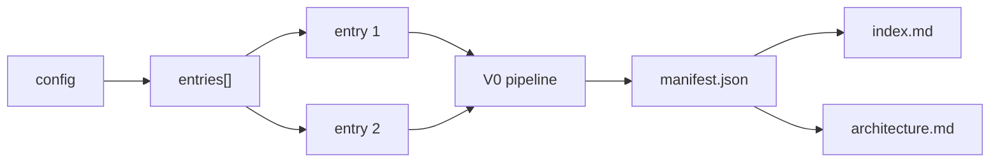

# Static Analysis V1

V1 is the first multi-entry slice of Prism static analysis. It reuses the complete V0 pipeline per entry, then adds a deterministic aggregate layer that keeps the per-entry reports intact.

## Status

| Slice | Status | What shipped |
| --- | --- | --- |
| Slice 1 | Done | Config normalization: `entry` still works, and `entries[]` accepts strings or `{ path, name? }` objects. |
| Slice 2 | Done | Sequential multi-entry orchestration: each entry runs through the existing V0 pipeline in order and keeps its own V0 workdir. |
| Slice 3 | Done | Aggregate outputs: `PRISM_WORKDIR/analyze/multi/<hash>/manifest.json`, `index.md`, and `architecture.md`. |
| Slice 4 | Done | Scope guard: `maxFiles` defaults to `1000` and is configurable via config or `--max-files <n>`. |
| Slice 5 | Done | Docs and handoff polish: README, this doc, roadmap pointer, and example config. |

## Current Behavior

- single-entry `prism analyze` still works
- config can live in a repo-local `.prism/analyze/*.json` file
- multi-entry runs execute entries sequentially
- each entry preserves its own V0 workdir and report shape
- aggregate `index.md` and `architecture.md` are written beside the per-entry workdirs
- over-budget single-entry runs fail before symbols
- over-budget multi-entry runs record the failed entry and continue siblings



## Non-Goals

- merged repo graph across entries
- cross-entry symbol deduplication or reconciliation
- LLM use inside static analysis V1
- new graph semantics for V1
- changes to V0 graph/report schemas or per-entry report pages
- HTML navigation redesign
- compare-runs UI
- architecture drift detection

## Config

V1 extends the existing config with `entries[]`. Single-entry config still works, and the repo-local convention is `.prism/analyze/*.json`.

```json
{
  "entries": [
    "src/app/page.tsx",
    {
      "path": "src/app/admin/page.tsx",
      "name": "admin"
    }
  ],
  "depth": 3,
  "maxFiles": 1000,
  "include": ["src/app/**", "src/components/**"],
  "exclude": ["generated/**"]
}
```

Normalization rules:

- `entry` stays supported for single-entry runs
- `entries[]` is supported for multi-entry runs
- each entry is resolved independently through the existing V0 scope rules
- `path` is the only required per-entry field
- `name` is optional and, when omitted, can be derived from the entry path
- shared config fields like `depth`, `maxFiles`, `include`, and `exclude` apply to every entry unless a later slice introduces per-entry overrides

`maxFiles` is a deterministic scope budget guard. It defaults to `1000`, can be set in config, and can be overridden with `--max-files <n>`.

## Output Layout

The V0 output layout remains intact for each entry. V1 adds a multi-entry wrapper alongside those existing per-entry workdirs, not around them.

```text
.tmp/analyze/
├── src__app__page.tsx-d3-<hash>/
│   └── ... V0 workdir unchanged ...
├── src__app__admin__page.tsx-d3-<hash>/
│   └── ... V0 workdir unchanged ...
└── multi/
    └── <config-hash>/
        ├── manifest.json
        ├── index.md
        └── architecture.md
```

The key constraint is that the per-entry V0 workdir stays exactly where it is today. The new multi-entry artifacts live beside it and only reference the per-entry outputs.

## Resume And Force

V1 preserves the same disk-backed stage model that makes V0 resumable.

- `--force` reruns all multi-entry orchestration and all per-entry V0 stages
- `--force-stage <name>` still targets the existing V0 stages inside each entry run
- a finished entry run can be reused when its requested inputs have not changed
- the multi-entry manifest, index, and architecture page are cacheable outputs and should be skipped when their inputs are unchanged
- if one entry is stale, only that entry reruns; the other entries remain reusable
- `--force` remains all-entry force unless a later slice introduces entry-scoped force
- if the aggregate inputs change because an entry was added, removed, renamed, or its resolved artifacts changed, the multi-entry index and architecture page rerun

## Aggregate Index And Architecture Page

The aggregate output makes a multi-entry run readable without changing any per-entry V0 report.

It should answer three questions:

1. what entries were analyzed
2. what each entry produced
3. what obvious cross-entry relationships exist at the orchestration level

Current contents for `multi/<config-hash>/manifest.json`:

- run metadata: config digest and normalized config, including `depth`, `maxFiles`, `include`, and `exclude`
- normalized entry list: entry name, entry path, resolved workdir, per-entry status
- per-entry snapshot: links to `scope.json`, `symbols.json`, `repo-index.json`, `graph.json`, `insights.json`, diagram manifest, and report entrypoints if they exist
- summary counts: files, symbols, edges, diagrams, insights per entry and totals across entries
- error messages for failed entries

Current contents for `multi/<config-hash>/index.md`:

- a stable table of entries with status, counts, and report links
- links to each entry's existing V0 report and key artifacts
- failure details when any entry failed

Current contents for `multi/<config-hash>/architecture.md`:

- entry cards for successful entries
- relative size comparison
- domain groups and top modules per entry
- shared folder prefixes with broad roots filtered out
- different-domain summaries
- skipped failed entries
- links to report, symbol directory, module directory, and repo index for each successful entry

The aggregate manifest should stay lightweight and reference-based. It should not duplicate full per-entry payloads.

## Deterministic Boundaries

| Boundary | Responsibility | Deterministic guarantee |
| --- | --- | --- |
| `multi-config` | Normalize `entries[]` and shared options | Stable entry order after normalization |
| `entry-schedule` | Resolve per-entry workdirs and cache keys | Same inputs always yield the same per-entry plan |
| `per-entry-v0` | Run the existing V0 pipeline for one entry | V0 determinism remains unchanged |
| `multi-manifest` | Record entry plans and statuses | Manifest content is derived only from normalized config and entry results |
| `multi-index` | Summarize the run and expose navigation | Index is a pure function of manifest plus per-entry artifacts |
| `multi-architecture` | Summarize successful entries from repo-index artifacts | Architecture page is a pure function of manifest plus successful `repo-index.json` files |

Deterministic guarantees for V1:

- entry ordering is stable and explicit
- per-entry workdirs remain isolated
- the aggregate index never invents graph facts
- the aggregate architecture page never merges graphs or infers runtime coupling
- scope budgets fail before symbol extraction
- repeated runs with the same normalized config and unchanged inputs produce identical multi-entry metadata
- failures are recorded per entry without changing the successful entry artifacts

## Tests And Verification

The verification shape is narrow and boring:

- config normalization tests for `entries[]`
- orchestration tests that prove each entry can reuse the V0 pipeline
- manifest/index determinism checks
- architecture page determinism checks
- failure-mode tests for one broken entry alongside one successful entry
- scope budget tests for single-entry and multi-entry runs
- smoke run with two or more entries that confirms the per-entry outputs still look like V0 and the aggregate index is populated

Operational checks:

- the same config should produce the same multi-entry ordering
- per-entry artifact paths should stay stable across reruns
- forcing one entry should not invalidate sibling entries
- the aggregate index should remain reference-based and small
