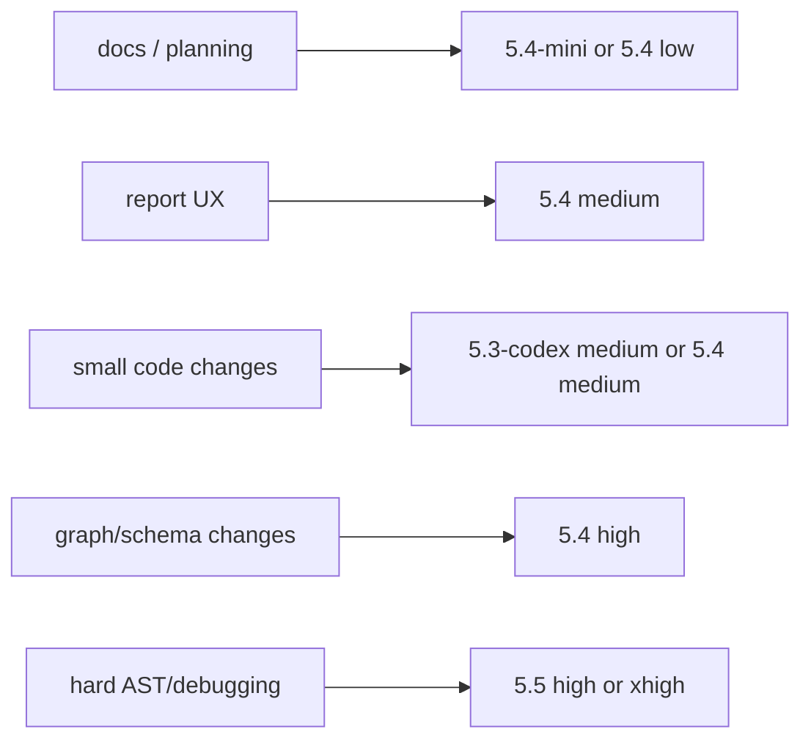

# Model Usage Guide

Use cheaper models by default for Prism static-analysis work. The repo now has
enough deterministic stages and tests that most changes do not need the most
expensive reasoning mode.

## Recommended Defaults



| Work | Recommended model |
| --- | --- |
| Roadmaps, docs, README | `5.4-mini` or `5.4 low` |
| Report layout/pages | `5.4 medium` |
| Tests and small bug fixes | `5.3-codex medium` or `5.4 medium` |
| AST extraction changes | `5.4 high` |
| Big architecture decisions | `5.5 high` |
| Very hard debugging only | `5.5 xhigh` |

## Suggested Prism Setup

For normal V0/V1 work:

```text
Main thread: 5.4 medium
Code-heavy patch: 5.3-codex medium or 5.4 medium
Hard parser/debug moment: 5.4 high or 5.5 high
Only if truly stuck: 5.5 xhigh
```

## What The Assistant Can And Cannot Do

The assistant cannot change the main conversation model from inside the chat.
That must be changed manually in the app/session settings.

The assistant can choose cheaper sub-agent models only when the user explicitly
asks for delegated/sub-agent work.

## Rule Of Thumb

Use the cheapest model that can safely preserve Prism's promises:

- deterministic behavior
- bounded scope
- resumable disk-backed stages
- stable JSON/report schemas
- strong tests around graph, coverage, and report behavior

Reserve `5.5 xhigh` for genuinely stuck moments, not routine docs, report
layout, or straightforward TypeScript changes.
